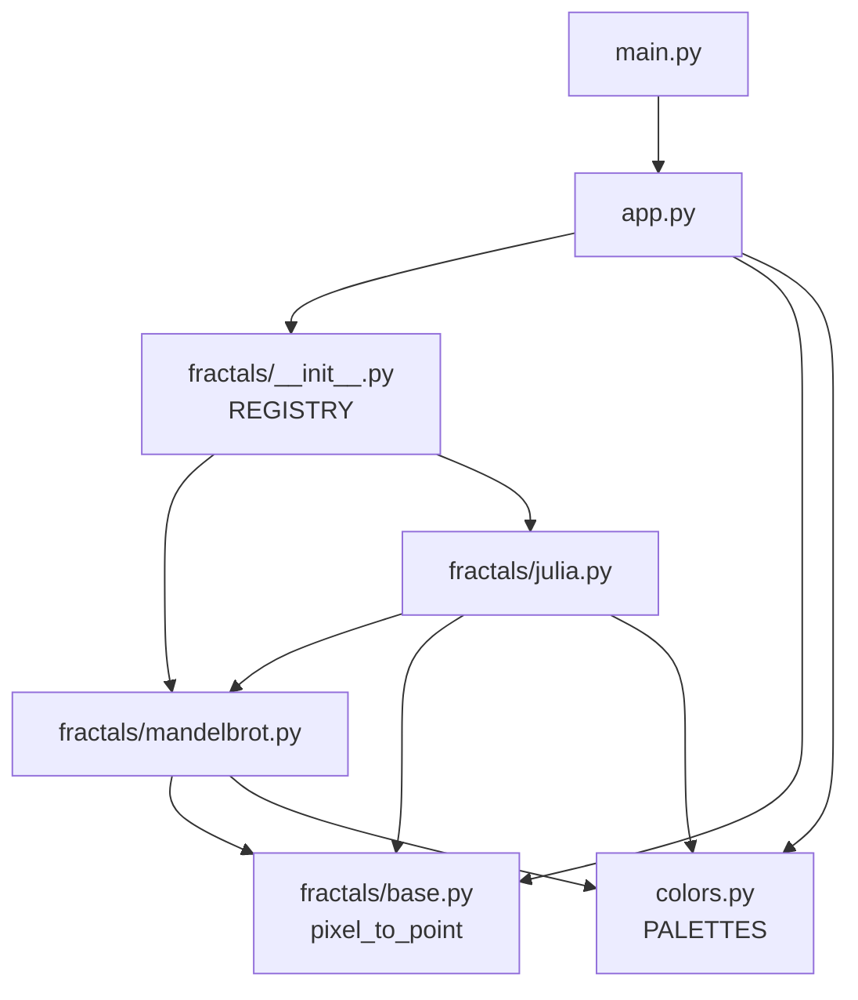
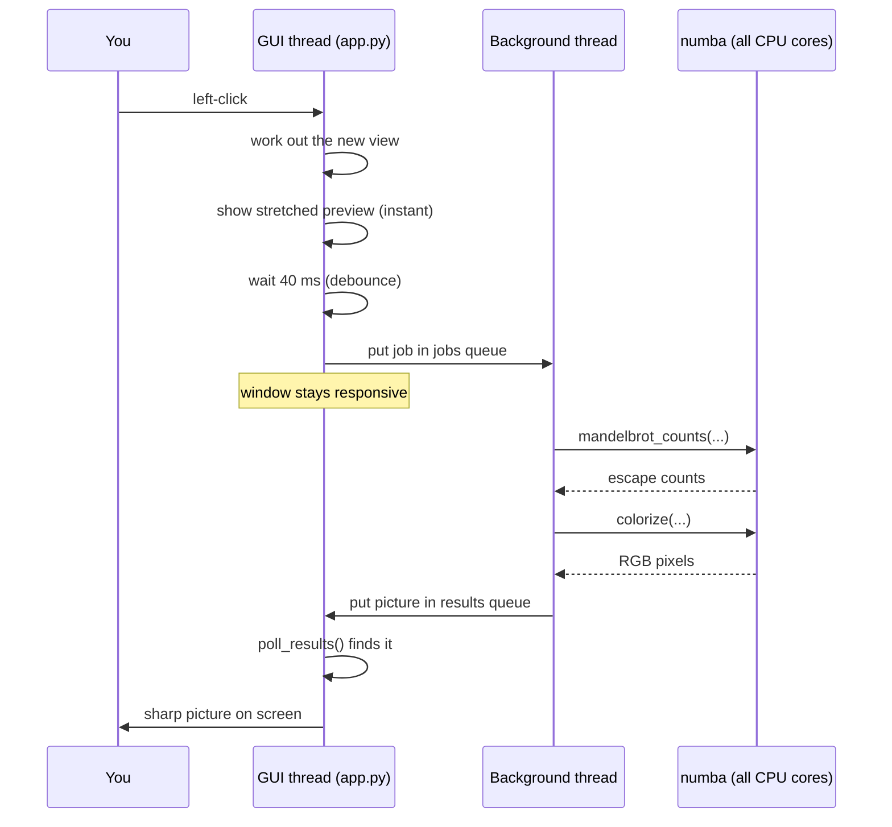

# How Fractal Maker Works

This guide explains the whole project in depth: the maths behind the
pictures, how the files fit together, and what happens inside the code when
you click. It assumes you know basic Python (functions, classes, imports),
but **no** knowledge of fractals, tkinter, threads or numba.

You don't have to read it in order. If you just want to see how everything
connects, jump to [Follow a click](#4-follow-a-click). If the maths is new to
you, start at [The maths, gently](#2-the-maths-gently).

## Contents

1. [What the app does](#1-what-the-app-does)
2. [The maths, gently](#2-the-maths-gently)
3. [Architecture overview](#3-architecture-overview)
4. [Follow a click](#4-follow-a-click)
5. [Concept explainers](#5-concept-explainers)
6. [File-by-file reference](#6-file-by-file-reference)
7. [Tutorial: add your own fractal](#7-tutorial-add-your-own-fractal)
8. [Try this: experiments](#8-try-this-experiments)
9. [Glossary](#9-glossary)
10. [Limits and FAQ](#10-limits-and-faq)

---

## 1. What the app does

Fractal Maker draws two famous fractals, the **Mandelbrot set** and **Julia
sets**, and lets you explore them:

- Click, scroll or drag a box to zoom in. There is detail at every level.
- Use sliders to change settings (how many iterations, which Julia set).
- Pick colour palettes, presets, and save the picture as a PNG.

Under the hood there are three jobs:

| Job | Where |
|---|---|
| Work out a number for every pixel (the maths) | `fractals/` |
| Turn those numbers into colours | `colors.py` |
| Show the picture and react to the mouse | `app.py` |

---

## 2. The maths, gently

### 2.1 Complex numbers are just 2D points

A **complex number** is written `x + y·i`. You can think of it as the point
`(x, y)` on a flat plane, called the **complex plane**. The horizontal axis is
the "real" part and the vertical axis is the "imaginary" part.

The special rule is `i · i = -1`. From that, multiplying two complex numbers
works out like this:

```
(a + b·i) · (c + d·i) = (a·c − b·d) + (a·d + b·c)·i
```

A useful mental picture is that **squaring a complex number squares its
distance from the centre and doubles its angle**. Points close to the centre
(distance < 1) get pulled in. Points far away (distance > 1) get flung out.

Python has complex numbers built in, written with `j` instead of `i`:

```python
>>> z = 1 + 2j
>>> z * z
(-3+4j)
>>> abs(z)        # distance from the centre, written |z|
2.23606797749979
```

### 2.2 The one formula: `z = z*z + c`

Every picture in this app comes from repeating this formula:

```
z = z*z + c
```

You start with some `z`, square it, add `c`, and then do it again, and again.
Each repeat is called an **iteration**. One of two things happens:

- `z` **stays small forever** (it bounces around near the centre), or
- `z` **escapes**: it gets bigger and bigger, heading to infinity.

Let's try two values of `c` by hand, starting from `z = 0`.

**c = 1:**

| step | z |
|---|---|
| start | 0 |
| 1 | 0² + 1 = **1** |
| 2 | 1² + 1 = **2** |
| 3 | 2² + 1 = **5** |
| 4 | 5² + 1 = **26** |
| 5 | 26² + 1 = **677** |

It escapes. So `c = 1` is **not** in the Mandelbrot set.

**c = −1:**

| step | z |
|---|---|
| start | 0 |
| 1 | 0² − 1 = **−1** |
| 2 | (−1)² − 1 = **0** |
| 3 | 0² − 1 = **−1** |
| 4 | … forever 0, −1, 0, −1 |

It stays small forever. So `c = −1` **is** in the Mandelbrot set.

**The Mandelbrot set is the collection of all `c` values for which `z`
(starting at 0) stays small forever.** To draw it, we treat every pixel as a
`c` value and run the formula:

- Pixels where `z` never escapes are drawn **black** (inside the set).
- Pixels where `z` escapes are coloured by **how many steps it took**. That's
  where the colourful bands come from.

This method is called the **escape-time algorithm**.

### 2.3 When do we know a point has escaped?

We can't loop forever, so we need two shortcuts:

1. **The escape radius.** It can be proven that once `|z| > 2`, `z` will
   definitely run off to infinity. (Roughly: when `z` is that big, squaring it
   grows it far more than adding `c` can pull it back.) So as soon as `|z|`
   passes 2, we stop and record the step number.
2. **The iteration limit.** Some points take thousands of steps to escape, and
   points in the set never escape. So we give up after `max_iter` steps (the
   "Max iterations" slider) and assume the point is inside.

> **Why does the code use 256 instead of 2?**
> In `fractals/mandelbrot.py` you'll see `ESCAPE_RADIUS_SQ = 256.0 ** 2`.
> Waiting until `|z| > 256` gives the same yes/no answer (if it passed 2, it
> will pass 256 a few steps later). Those extra steps make the *smooth
> colouring* below much more accurate.
>
> We also compare the **squared** distance (`x² + y²`) to `256²`. That avoids
> calculating a square root on every step, which is a small speed win.

### 2.4 Smooth colouring

If we coloured pixels by the whole step number (5, 6, 7…), we'd see sharp
stripes, because every pixel that escaped on step 6 gets the exact same
colour. To blend the stripes, the code adds a *fraction* that measures how far
past the escape radius `z` got:

```python
return n + 1 - math.log(math.log(math.sqrt(mag_sq))) / LOG2
```

`math.sqrt(mag_sq)` is `|z|`, so this is `n + 1 − log₂(log |z|)`.

Why does that work? Once `z` is large, each step roughly *squares* `|z|`.
Taking `log` twice turns "squaring" into "adding 1":

- if `|z|` squares, then `log |z|` doubles,
- and if `log |z|` doubles, then `log₂(log |z|)` goes up by exactly 1.

So `log₂(log |z|)` acts like a step counter that moves smoothly instead of
jumping. Subtracting it from `n` gives a number like `6.37` instead of just
`6`, and neighbouring pixels get slightly different colours.

### 2.5 Mandelbrot vs Julia

Julia sets use **the same formula** but swap the roles of `z` and `c`:

| | Mandelbrot | Julia |
|---|---|---|
| `c` | different for each pixel (the pixel's position) | **one fixed number** for the whole picture |
| starting `z` | always `0` | the pixel's position |
| how many pictures | one | infinitely many, one per `c` |

So every point `c` has its own Julia set. There's a famous connection:

- If `c` is **inside** the Mandelbrot set, its Julia set is one connected
  shape.
- If `c` is **outside**, the Julia set shatters into disconnected "dust".

You can see this in the app: **Shift+click** on the Mandelbrot set opens the
Julia set for that exact `c`. Try clicking inside the black area, then just
outside it. (The "Dust (disconnected)" preset is an example of the second
case.)

---

## 3. Architecture overview

### 3.1 The files

```
fractal_maker/
├── main.py              starts the app
├── app.py               the window: canvas, sidebar, mouse, background thread
├── colors.py            palettes; turns escape counts into RGB colours
└── fractals/
    ├── __init__.py      REGISTRY: the list of fractals shown in the dropdown
    ├── base.py          the Fractal "contract" + Param + coordinate helpers
    ├── mandelbrot.py    Mandelbrot set + escape_count (the core loop)
    └── julia.py         Julia sets (reuses escape_count)
```

### 3.2 Who uses whom



Arrows point from a file to the file it imports.

### 3.3 What each file is responsible for

- **`main.py`** is tiny. It creates the tkinter window (`tk.Tk()`), builds a
  `FractalApp` inside it, and starts tkinter's event loop (`mainloop()`).
- **`app.py`** holds everything you see and touch. It builds the sidebar,
  turns mouse clicks into new views, runs a background thread for rendering,
  and puts finished pictures on the canvas. It **never does fractal maths
  itself**.
- **`fractals/base.py`** defines what a fractal must look like (the `Fractal`
  class) and two helpers for converting between screen pixels and points on
  the complex plane.
- **`fractals/mandelbrot.py`** and **`fractals/julia.py`** each define one
  fractal. They create a grid of complex numbers, run the escape-time loop on
  every pixel, and ask `colors.py` to colour the result.
- **`fractals/__init__.py`** lists the available fractals in `REGISTRY`. The
  dropdown in the window is built from this list.
- **`colors.py`** builds the palettes and turns a grid of escape counts into
  an RGB image.

### 3.4 The key design idea: the `Fractal` contract

`app.py` doesn't know *how* any fractal is drawn. It only knows that every
fractal has:

```python
class Fractal:
    name = "Base"        # shown in the dropdown
    params = {}          # {key: Param(...)}: the window makes a slider for each
    presets = {}         # optional named starting points
    zoomable = False     # should clicking/scrolling zoom?

    def default_view(self): ...                               # where to start
    def render(self, width, height, view, settings): ...      # -> PIL image
```

As long as a class follows this "contract", the window can show it. That's
why adding a new fractal (see the [tutorial](#7-tutorial-add-your-own-fractal))
doesn't need any changes to `app.py`. Programmers call this an **interface**:
the window depends on *what* a fractal can do, not *how* it does it.

Two pieces of data travel through the contract:

- **`view = (center_x, center_y, width)`** says which part of the complex
  plane to show. Zooming in just means making `width` smaller. The height
  isn't stored; it follows from the window's shape
  (`height = width × pixels_high / pixels_wide`), so pictures never look
  stretched.
- **`settings`** is a plain dictionary with one value per slider, plus
  `"palette"`. For example:
  `{"palette": "Fire", "c_real": -0.8, "c_imag": 0.156, "max_iter": 300}`.

---

## 4. Follow a click

This section follows **one left-click** on the Mandelbrot set from your
finger to the new picture on screen. Every function named here exists in the
code, so you can open the file and follow along.

The big picture first. Two **threads** (two things running at the same time)
work together:



### Step 1: tkinter notices the click

In `bind_mouse()` the canvas is told which function to call for each mouse
event:

```python
c.bind("<ButtonPress-1>", self.on_left_press)
c.bind("<B1-Motion>", self.on_left_drag)
c.bind("<ButtonRelease-1>", self.on_left_release)
```

Pressing the button calls `on_left_press`. It only remembers where you pressed
and whether Shift was held:

```python
def on_left_press(self, event):
    shift_held = event.state & 0x0001
    self.drag_start = (event.x, event.y, shift_held)
```

(`event.state` is a number whose individual bits record which keys are held.
Bit 1 is Shift, so `& 0x0001` checks just that bit.)

Releasing the button calls `on_left_release`, which decides what you meant:

```python
if shift_held and self.fractal.name == "Mandelbrot":
    self.open_julia_at(event.x, event.y)        # Shift+click
elif dragged:
    self.zoom_to_box(x0, y0, event.x, event.y)  # you dragged a box
else:
    self.zoom_centered(event.x, event.y, 0.5)   # a plain click
```

A plain click means `zoom_centered(..., 0.5)`: halve the width, so the zoom is
×2.

### Step 2: convert the pixel into a point on the complex plane

The click arrives in **screen pixels**, for example `(600, 200)`. The maths
needs a **point on the plane**, for example `(-0.74, 0.13)`. `to_point` calls
`pixel_to_point` in `fractals/base.py`:

```python
def pixel_to_point(px, py, width, height, view):
    cx, cy, w = view
    h = w * height / width
    x = cx - w / 2 + (px / width) * w
    y = cy + h / 2 - (py / height) * h
    return x, y
```

Read it like this:

- `cx - w / 2` is the left edge of the view. `px / width` is how far across
  the screen you clicked, as a fraction from 0 to 1. Multiply that fraction by
  the view width and add it to the left edge.
- For `y` it's the same idea, starting from the **top** edge `cy + h / 2`. We
  *subtract* because screen y grows downwards while maths y grows upwards.

`zoom_centered` then makes that point the new centre, at half the width:

```python
x, y = self.to_point(px, py)
self.set_view(x, y, self.view[2] * factor)
```

### Step 3: `set_view`, the funnel every zoom goes through

```python
def set_view(self, cx, cy, w):
    """Every zoom ends up here."""
    if not self.fractal.zoomable:
        return
    self.view = (cx, cy, w)
    self.show_zoom_preview()
    self.schedule_render()
```

Click zoom, scroll zoom and box zoom all end here, so the "is this fractal
zoomable?" check only has to be written once.

### Step 4: the instant preview

Rendering takes a fraction of a second, but a zoom should *feel* instant. So
`show_zoom_preview` takes the last finished picture and immediately stretches
it to match the new view. It's blurry, but it's on screen within about 10 ms.

How does it know how to stretch? For each pixel of the **new** picture, it
works out which pixel of the **old** picture shows the same maths point. That
turns out to be a simple formula:

```
old_pixel = scale × new_pixel + offset
```

- `scale = new_width / old_width`. If you zoomed in ×2, `scale = 0.5`: moving
  one pixel in the new picture moves half a pixel in the old one.
- `offset` is how far the new view's top-left corner is from the old one's,
  measured in old pixels.

Pillow's `Image.transform(..., Image.AFFINE, (scale, 0, x_offset, 0, scale,
y_offset))` applies exactly that formula to every pixel. A formula of this
shape (scale plus shift) is called an **affine transform**. Areas the old
picture didn't cover (when zooming out) come out black.

### Step 5: wait a moment, then hand off a job

`schedule_render` doesn't render straight away. It sets a 40 ms timer, and
cancels any timer already running:

```python
if self.pending_render is not None:
    self.root.after_cancel(self.pending_render)
self.pending_render = self.root.after(RENDER_DELAY_MS, self.render)
```

If you scroll five times quickly, only the **last** scroll actually renders.
This trick is called **debouncing** (see [concepts](#54-debouncing)).

When the timer fires, `render()` packs everything the worker needs into a
**job** and drops it in the `jobs` queue:

```python
self.generation += 1
self.jobs.put((self.generation, self.fractal, width, height,
               self.view, self.current_settings()))
```

`current_settings()` reads every slider into a plain dictionary *now*, on the
GUI thread. The worker thread is not allowed to touch tkinter widgets (see
[threads](#52-threads-and-queues)).

The **generation** number is a label for "the newest request". It goes up by
one every time. You'll see why it matters in step 8.

`render()` then returns **immediately**. The window keeps responding to your
mouse while the picture is computed.

### Step 6: the background thread does the maths

`render_worker` runs forever in its own thread, which was started in
`__init__`:

```python
while True:
    job = self.jobs.get()            # wait for work
    while not self.jobs.empty():     # skip straight to the newest job
        job = self.jobs.get()
    generation, fractal, width, height, view, settings = job

    start = time.perf_counter()
    image = fractal.render(width, height, view, settings)
    seconds = time.perf_counter() - start
    self.results.put((generation, image, view, seconds))
```

`self.jobs.get()` sleeps until a job arrives. If several jobs piled up while
the worker was busy, it throws the old ones away and only does the newest.

`fractal.render(...)` is `Mandelbrot.render` in `fractals/mandelbrot.py`:

```python
def render(self, width, height, view, settings):
    c = complex_grid(width, height, view)
    counts = mandelbrot_counts(c, settings["max_iter"])
    return Image.fromarray(colorize(counts, settings["palette"]))
```

Three steps:

**6a. `complex_grid`** (in `base.py`) builds a 2D numpy array with one complex
number per pixel. It reuses `pixel_to_point` from step 2, but on whole numpy
arrays at once instead of a single pixel:

```python
columns = np.arange(width)[np.newaxis, :]  # a row of x pixel positions
rows = np.arange(height)[:, np.newaxis]    # a column of y pixel positions
x, y = pixel_to_point(columns, rows, width, height, view)
return x + 1j * y
```

The `np.newaxis` trick turns one list into a row and the other into a column.
When numpy adds a row to a column it **broadcasts** them into a full grid: a
`(1, width)` row plus a `(height, 1)` column gives a `(height, width)` grid.

**6b. `mandelbrot_counts`** loops over every pixel and runs `escape_count`
(section 2) on it:

```python
@njit(parallel=True, cache=True, nogil=True)
def mandelbrot_counts(c, max_iter):
    height, width = c.shape
    counts = np.empty((height, width))
    for row in prange(height):
        for col in range(width):
            counts[row, col] = escape_count(0j, c[row, col], max_iter)
    return counts
```

A full-screen window has about 4 million pixels, each doing up to hundreds of
iterations. In plain Python that would take minutes. The `@njit` decorator
from **numba** compiles this function to machine code, and `prange` splits the
rows between all your CPU cores. See [numba](#53-numba-making-python-loops-fast).

The result is a grid of floats: a smooth escape count for each pixel, or `NaN`
("not a number") for pixels inside the set.

**6c. `colorize`** turns those numbers into colours. See step 7.

### Step 7: numbers become colours

In `colors.py`, each palette is a short list of colours ("stops"):

```python
"Fire": [(0, 0, 0), (128, 0, 0), (255, 80, 0),
         (255, 200, 0), (255, 255, 210), (0, 0, 0)],
```

At startup, `build_lut` blends between the stops to make a table of 256
colours, called a **lookup table (LUT)**. The first and last stops are the
same colour, so the table loops around smoothly.

For each pixel, `_colorize` then:

1. **Leaves it black** if the count is `NaN` (inside the set).
2. **Picks a position in the table**:
   ```python
   position = (math.sqrt(max(value, 0.0)) * COLOR_DENSITY) % LUT_SIZE
   ```
   - The square root squashes big numbers, so deep zooms (where counts reach
     thousands) don't cycle through colours too fast.
   - `COLOR_DENSITY` controls how many colour bands you see.
   - `% LUT_SIZE` wraps around, so position 300 becomes 44.
3. **Blends two neighbouring entries**. A position like `41.3` means "70% of
   entry 41 plus 30% of entry 42", which avoids visible steps between colours.

The result is a `(height, width, 3)` array of bytes (red, green, blue), and
`Image.fromarray` turns it into a Pillow image.

### Step 8: back to the GUI thread

The worker puts the finished picture into the `results` queue. The worker
can't put it on screen itself, because only the GUI thread may touch
tkinter.

So the GUI thread checks the queue every 15 ms in `poll_results`:

```python
while not self.results.empty():
    generation, image, view, seconds = self.results.get()
    if generation == self.generation:  # ignore outdated pictures
        self.image, self.image_view = image, view
        self.display(image)
        ...
self.root.after(POLL_MS, self.poll_results)   # check again soon
```

**This is where the generation number pays off.** Imagine you click, and then
click again before the first render finishes. The first picture arrives with
generation 7, but `self.generation` is already 8. The picture is out of date,
so it's thrown away instead of briefly flashing the wrong view.

### Step 9: on screen

`display` converts the Pillow image into something tkinter can draw and puts
it on the canvas:

```python
self.photo = ImageTk.PhotoImage(image)
self.canvas.delete("image")
self.canvas.create_image(0, 0, anchor="nw", image=self.photo, tags="image")
self.canvas.tag_lower("image")  # keep the zoom box drawn on top
```

> **Gotcha:** `self.photo = ...` isn't just tidy code. If the `PhotoImage` is
> only stored in a local variable, Python deletes it when the function ends,
> and tkinter shows a blank canvas. Storing it on `self` keeps it alive.

The status bar updates to `Rendered in 0.12 s`. Done.

---

## 5. Concept explainers

### 5.1 tkinter's event loop and `after()`

A tkinter program doesn't run top to bottom and finish. `root.mainloop()` (in
`main.py`) starts an **event loop**: a loop that waits for something to
happen (a click, a key, a timer) and calls the function you connected to it.

Two consequences:

- **Never do slow work in an event handler.** While your function runs, the
  loop can't process anything else, so the window freezes. That's why
  rendering happens in a separate thread.
- **`root.after(ms, func)`** asks the loop to call `func` later, without
  blocking. The app uses it for the 40 ms debounce timer and for
  `poll_results` checking every 15 ms. A function that calls `after` on
  itself at the end, like `poll_results`, keeps repeating forever.

### 5.2 Threads and queues

A **thread** is a separate line of execution inside the same program. This
app has two:

- the **GUI thread**, which runs the tkinter event loop, and
- the **worker thread**, started in `__init__` with
  `threading.Thread(target=self.render_worker, daemon=True).start()`.

`daemon=True` means "don't keep the program alive just for this thread", so
closing the window ends the app.

**Rule: only the GUI thread may touch tkinter.** tkinter isn't
*thread-safe*: if two threads change widgets at the same time, it can crash
or misbehave. So the threads never call each other directly. Instead they
pass messages through two **queues** (`queue.Queue`), which *are* safe to use
from several threads:

```
GUI thread  --jobs-->  worker thread  --results-->  GUI thread
```

A queue is like a letterbox: one side drops things in, the other takes them
out in order.

### 5.3 numba: making Python loops fast

Normal Python is *interpreted*: every line is looked up and executed one by
one, which is slow for tight maths loops. **numba** is a **JIT compiler**
("just-in-time"): the first time you call a decorated function, it translates
it into machine code, the same kind of code C produces. Every later call
runs that fast version.

The decorator options used in this project:

| Option | Meaning |
|---|---|
| `@njit` | compile this function ("no-Python mode": it must only use numbers, numpy arrays and simple Python) |
| `parallel=True` + `prange` | split this loop's iterations across all CPU cores |
| `nogil=True` | release Python's **GIL** while running, so the GUI thread can keep going at the same time |
| `cache=True` | save the compiled code in `__pycache__`, so the next launch doesn't need to compile again |
| `inline="always"` | paste `escape_count` directly into the loops that call it, avoiding the overhead of a function call per pixel |

**What's the GIL?** Python's *Global Interpreter Lock* lets only one thread
run Python code at a time. Without `nogil=True`, the worker thread would hold
the lock during rendering and the GUI would freeze anyway.

**Limitations to know about:** numba only understands a subset of Python. For
example, the version used here doesn't support `math.log2`, which is why the
code computes `math.log(...) / LOG2` instead. If you add code inside an
`@njit` function and get a `TypingError`, that's usually the reason.

### 5.4 Debouncing

Dragging a slider fires dozens of change events per second. Rendering for
each one would waste time on pictures nobody sees. **Debouncing** means
"wait until the changes stop for a moment, then act once":

1. A change happens → start a 40 ms timer.
2. Another change within 40 ms → cancel the timer and start a new one.
3. The timer finally fires → render once, with the latest settings.

The name comes from electronics: a physical button "bounces" and sends several
signals when pressed once, and debouncing cleans that up.

### 5.5 Lookup tables

Calculating a blended colour from the palette stops for every one of millions
of pixels would be wasteful. Instead, `build_lut` does the blending **once**
at startup and stores 256 ready-made colours. Each pixel then just looks up
its colour by position. Precomputing answers so you can look them up later is
a common speed trick called a **lookup table (LUT)**.

---

## 6. File-by-file reference

### `main.py`

| Name | What it does |
|---|---|
| `main()` | Creates the window, builds `FractalApp`, starts the event loop. |

### `app.py`

| Name | What it does |
|---|---|
| `RENDER_DELAY_MS`, `POLL_MS`, `DRAG_THRESHOLD` | Tuning constants: debounce delay, how often to check for results, how far the mouse must move to count as a drag. |
| `FractalApp.__init__` | Sets up state, the queues and the worker thread, builds the window, shows the first fractal. |
| `build_layout` | Creates the status bar, sidebar (dropdowns, buttons, help text) and canvas. |
| `add_dropdown` | Helper: a label plus a read-only dropdown that calls a function when you pick something. |
| `build_param_controls` | Rebuilds the sliders and presets for the current fractal from its `params` and `presets`. |
| `switch_fractal` | Creates the chosen fractal from `REGISTRY`, rebuilds its controls, resets the view. |
| `apply_preset` | Sets the sliders to a preset's values and resets the view. |
| `reset_view` | Goes back to the fractal's `default_view()`. |
| `current_settings` | Reads all sliders into a dict for `render()`, rounding whole-number params. |
| `schedule_render` | Debounces: asks for a render in 40 ms, cancelling any earlier request. |
| `render` | Puts a job (with a new generation number) in the `jobs` queue. |
| `render_worker` | Background thread: takes the newest job, renders it, puts the picture in `results`. |
| `poll_results` | GUI thread, every 15 ms: shows any up-to-date finished picture. |
| `display` | Puts a Pillow image on the canvas. |
| `show_zoom_preview` | Instantly stretches the last picture to the new view (affine transform). |
| `update_status` | Writes cursor position, zoom level and render time to the status bar. |
| `save_png` | Asks for a filename and saves the last finished picture. |
| `bind_mouse` | Connects mouse events to their handler functions. |
| `on_resize` | Remembers the new canvas size and re-renders. |
| `to_point` | Screen pixel → complex-plane point, for the current view. |
| `on_left_press` / `on_left_drag` / `on_left_release` | Click, drag-a-box and Shift+click handling. |
| `zoom_centered` | Zoom with the clicked point moved to the centre (left and right click). |
| `zoom_fixed` | Zoom keeping the point under the cursor still (scroll wheel). |
| `zoom_to_box` | Zoom so the dragged box fills the screen. |
| `set_view` | Every zoom goes through here: check `zoomable`, update view, preview, schedule render. |
| `open_julia_at` | Switches to Julia with `c` set to the clicked point. |

### `colors.py`

| Name | What it does |
|---|---|
| `PALETTES` | Colour stops for each palette. Add your own here. |
| `LUT_SIZE`, `COLOR_DENSITY` | Table size (256) and how quickly colours cycle. |
| `build_lut` | Blends the stops into a 256-colour table using `np.interp`. |
| `LUTS` | The table for every palette, built once at startup. |
| `colorize` | Public function: escape counts + palette name → RGB array. |
| `_colorize` | The numba loop that does the per-pixel colouring. |

### `fractals/base.py`

| Name | What it does |
|---|---|
| `Param` | Describes one slider: label, default, min, max, step. |
| `Fractal` | The base class / contract every fractal follows. |
| `pixel_to_point` | Pixel → complex-plane coordinates (works on single numbers or numpy arrays). |
| `complex_grid` | One complex number per pixel, as a 2D numpy array. |

### `fractals/mandelbrot.py`

| Name | What it does |
|---|---|
| `ESCAPE_RADIUS_SQ`, `LOG2` | The squared escape radius (256²) and `log(2)` for smooth colouring. |
| `escape_count` | The core loop `z = z*z + c` for **one** point. Returns a smooth count or `NaN`. |
| `mandelbrot_counts` | Runs `escape_count` on every pixel, with `z` starting at 0. |
| `Mandelbrot` | The fractal class: params, default view, `render()`. |

### `fractals/julia.py`

| Name | What it does |
|---|---|
| `julia_counts` | Runs `escape_count` on every pixel, with `z` = pixel and one fixed `c`. |
| `Julia` | The fractal class, with `c` sliders and presets. |

### `fractals/__init__.py`

| Name | What it does |
|---|---|
| `REGISTRY` | `{name: class}` for every fractal in the dropdown. |

---

## 7. Tutorial: add your own fractal

Let's add a **fractal tree**: a trunk that splits into two smaller branches,
each of which splits into two smaller branches, and so on. This is a
*recursive* fractal: a function that calls itself.

### Step 1: create `fractals/tree.py`

```python
import math

from PIL import Image, ImageDraw

from .base import Fractal, Param


class Tree(Fractal):
    name = "Fractal tree"
    zoomable = False   # drawn with lines, not per pixel, so zooming makes no sense
    params = {
        "depth": Param("Depth", 10, 1, 14, 1),
        "angle": Param("Branch angle", 25.0, 0.0, 90.0, 1.0),
    }

    def render(self, width, height, view, settings):
        img = Image.new("RGB", (width, height), "black")
        draw = ImageDraw.Draw(img)

        def branch(x, y, length, direction, depth):
            if depth == 0:
                return  # stop the recursion
            # Work out where this branch ends, using a bit of trigonometry.
            x2 = x + length * math.cos(math.radians(direction))
            y2 = y - length * math.sin(math.radians(direction))  # minus: screen y points down
            draw.line([(x, y), (x2, y2)], fill=(120, 220, 120),
                      width=max(1, depth // 2))
            # Each branch splits into two shorter ones: the recursion.
            branch(x2, y2, length * 0.7, direction + settings["angle"], depth - 1)
            branch(x2, y2, length * 0.7, direction - settings["angle"], depth - 1)

        # Start at the bottom middle, pointing straight up (90 degrees).
        branch(width / 2, height, height / 4, 90, settings["depth"])
        return img
```

Things to notice:

- **`zoomable = False`**. The tree is drawn with lines in pixel coordinates
  and ignores `view`. `set_view` checks this flag and ignores zoom clicks.
- **`params`** gives us two sliders, "Depth" and "Branch angle", with no
  changes to `app.py`. `depth` has a whole-number default (`10`), so
  `current_settings` rounds it to an `int`. `angle` has a decimal default
  (`25.0`), so it stays a float.
- **No numba needed.** A depth-14 tree is only about 16,000 lines, which
  Pillow draws quickly. numba is only worth it for per-pixel work.
- **It ignores `settings["palette"]`.** That's fine; using it is optional.

### Step 2: register it

In `fractals/__init__.py`:

```python
from .julia import Julia
from .mandelbrot import Mandelbrot
from .tree import Tree

REGISTRY = {
    Mandelbrot.name: Mandelbrot,
    Julia.name: Julia,
    Tree.name: Tree,
}
```

### Step 3: run it

```bash
python3 main.py
```

Pick "Fractal tree" in the dropdown and drag the sliders. Each depth level
doubles the number of branches, so depth 14 has 2¹⁴ = 16,384 twigs.

### Ideas for next fractals

- **Sierpinski triangle:** draw a triangle, then recursively draw three
  half-size triangles in its corners.
- **Koch snowflake:** replace each straight line with four shorter lines
  that have a "bump" in the middle, recursively.
- **Barnsley fern:** start at a point, then repeat thousands of times: pick
  one of four simple transformations at random, apply it, and plot the point.
  For speed, use a numba loop like `mandelbrot_counts`.

---

## 8. Try this: experiments

Small changes that teach you something. After each change, run
`python3 main.py`. numba recompiles automatically when its source file
changes, so the first render may take a few seconds. Use `git diff` to see
what you changed and `git checkout -- <file>` to undo it.

1. **More or fewer colour bands.** In `colors.py`, change
   `COLOR_DENSITY = 24.0` to `8.0` (smooth and calm) or `80.0` (busy).
2. **Make your own palette.** Add a line to `PALETTES`, such as
   `"Mint": [(0, 20, 10), (0, 200, 120), (230, 255, 240), (0, 20, 10)],`.
   It appears in the dropdown automatically.
3. **See why smooth colouring matters.** In `escape_count`, replace the
   smooth `return` line with `return float(n)`. Visible stripes appear.
4. **Change the escape radius.** Set `ESCAPE_RADIUS_SQ = 2.0 ** 2`. The set
   itself looks the same (the yes/no answer is unchanged), but the colour
   gradients become less smooth. That's why the code uses 256.
5. **The Multibrot.** In `escape_count`, change `z = z * z + c` to
   `z = z * z * z + c`. The heart-shaped body becomes two big mirrored lobes
   (in general, `z` to the power `n` gives `n − 1` lobes). Julia sets change
   too because they share this function. (For perfectly smooth
   colours, also change `LOG2` to `math.log(3.0)`.)
6. **Add a Julia preset.** Find a nice spot by Shift+clicking the Mandelbrot
   set, read `c` off the sliders, and add it to `Julia.presets` in
   `fractals/julia.py`.
7. **Feel the debounce.** In `app.py`, set `RENDER_DELAY_MS = 500` and drag a
   slider. The picture waits until you stop. Then try `0`.
8. **Iterations vs detail.** Zoom deep into the edge of the set (for example
   near `x = -0.7436, y = 0.1318`) and compare "Max iterations" at 100 and
   2000. With too few iterations, slowly escaping points are wrongly treated
   as inside, and the fine detail turns into black blobs.

---

## 9. Glossary

| Term | Meaning |
|---|---|
| **Affine transform** | A "scale and shift" mapping between coordinates. Used for the instant zoom preview. |
| **Broadcasting** | numpy's rule for combining arrays of different shapes, such as a row plus a column giving a grid. |
| **Complex number** | A number `x + y·i`, which you can treat as a point `(x, y)`. Python writes it `x + yj`. |
| **Complex plane** | The flat 2D surface where each point is a complex number. |
| **Debounce** | Wait until changes stop for a moment, then act once. |
| **Escape radius** | Once `|z|` passes this, `z` is known to head to infinity. 2 is enough; the code uses 256. |
| **Escape-time algorithm** | Colour each point by how many iterations it takes to escape. |
| **Event loop** | tkinter's `mainloop()`: waits for events and calls your handler functions. |
| **Generation number** | A counter that labels each render request, so outdated results can be ignored. |
| **GIL** | Global Interpreter Lock: lets only one thread run Python code at a time. numba's `nogil=True` releases it. |
| **Iteration** | One repeat of `z = z*z + c`. |
| **JIT compiler** | Compiles code to machine code the first time it's run ("just in time"). numba is one. |
| **Julia set** | The points `z` that stay bounded for one fixed `c`. |
| **LUT (lookup table)** | Precomputed answers (here, 256 colours) to look up instead of recalculating. |
| **Mandelbrot set** | The values `c` for which `z` (starting at 0) stays bounded. |
| **NaN** | "Not a number": a special float. Here it marks "inside the set". |
| **Queue** | A thread-safe letterbox for passing messages between threads. |
| **Thread** | A separate line of execution running at the same time as the rest of the program. |
| **View** | `(center_x, center_y, width)`: which part of the complex plane is on screen. |

---

## 10. Limits and FAQ

**Why does a very deep zoom turn blocky?**
Around 10¹³× zoom, neighbouring pixels differ by less than the smallest step
a normal 64-bit float can represent, so many pixels get the same number.
Going deeper needs special arbitrary-precision maths, which is much slower.

**Why is the first launch slow?**
numba compiles the `@njit` functions the first time. With `cache=True` the
result is saved in `__pycache__`, so later launches start quickly. Editing
one of those files triggers a recompile.

**Why is numba required?**
Without it, the same loops in plain Python would take minutes per picture.
An earlier version had a numpy fallback, but it duplicated all the maths in a
harder-to-read form, so it was removed to keep the code simple.

**Why does `escape_count` live in `mandelbrot.py` if Julia uses it too?**
It's the Mandelbrot formula, and Julia sets are defined in terms of it.
`julia.py` imports it rather than duplicating it.

**Why not draw each pixel straight onto the tkinter canvas?**
Creating millions of canvas items would be extremely slow. Instead, the whole
picture is built as one image in memory and handed to the canvas in one go.

**Can the window freeze at all?**
Only briefly, for a few tens of milliseconds, when converting a very large
finished image into a `PhotoImage` (step 9). That conversion has to happen on
the GUI thread.
